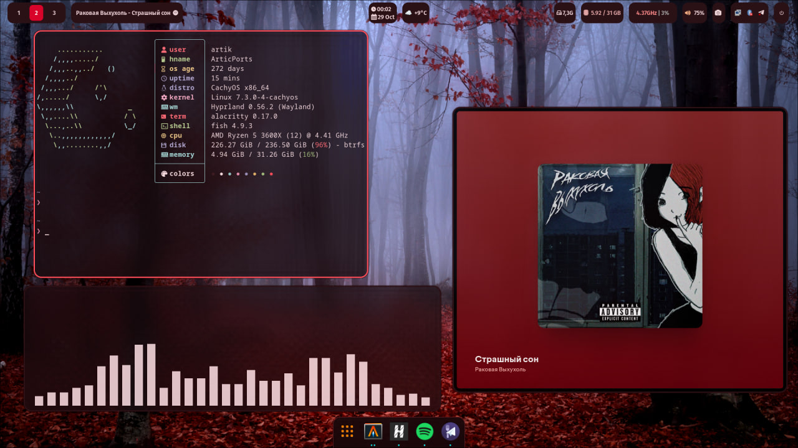

# CachyOS Hyprland Dotfiles

Hyprland + Waybar + Mako + Rofi + Wofi + nwg-dock-hyprland, red/dark theme.



## Install

```bash
git clone https://github.com/Artic2010th/dotfiles.git
cd dotfiles
./install.sh
```

The script backs up existing configs to `~/.config-backup-<timestamp>` and copies the configs into `~/.config`. It does not install packages.

Dependencies: Hyprland, Waybar, Mako, Rofi, Wofi, nwg-dock-hyprland, swaybg, grimblast, slurp, swappy, cliphist, wl-clipboard, playerctl, fcitx5, wob, network-manager-applet, polkit-kde-agent.

The wallpaper is not included. Put it at `~/Pictures/wallpapers/les_bordovye_osen.jpg` or edit `~/.config/hypr/config/autostart.conf`.
